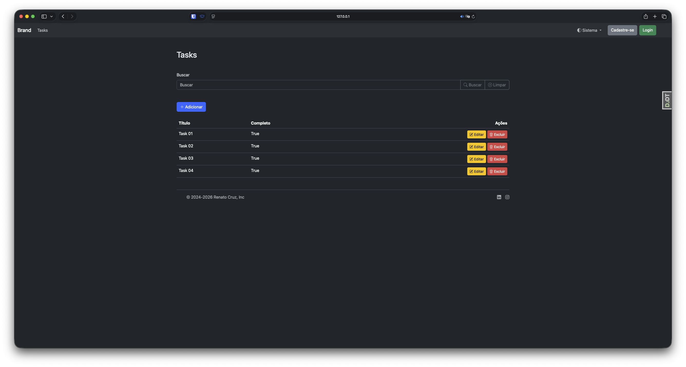

[](https://github.com/natorsc/py-django)
[](https://github.com/natorsc/py-django)
[](https://github.com/natorsc/py-django)
[](./LICENSE)

# py-django

Exemplo de projeto web com Python e o framework web Django.

## Tecnologias

[](https://www.python.org/)
[](https://github.com/django/django)
[](https://github.com/astral-sh/uv)

## Autor

Criado com 💙 por **Renato Cruz**.

Se tiver alguma dúvida, sugestão ou feedback, fique à vontade para entrar em contato.

[](mailto:natorsc@gmail.com)

### 🎵 O que estou ouvindo enquanto programo ou estudo

[](https://open.spotify.com/playlist/1xf3u29puXlnrWO7MsaHL5)

## 💝 Apoie este projeto

Se este projeto foi útil para você, considere apoiar seu desenvolvimento. Sua contribuição ajuda a manter o projeto e incentiva a criação e o compartilhamento de novos conteúdos.

### GitHub Sponsors

https://github.com/sponsors/natorsc/

### Pix

`b1839493-2afe-484d-9272-82a3e402b36f`

## Django

- [Site oficial](https://github.com/django/django).

### Principais comandos

```bash
# Inicia um novo app dentro do projeto:
uv run python manage.py startapp
# Cria um usuário administrador (Django admin):
uv run python manage.py createsuperuser
# Remove os dados e mantem as tabelas:
uv run python manage.py flush
# Exclui e recria o banco de dados:
uv run python manage.py reset_db
# Prepara as migrações:
uv run python manage.py makemigrations
# Executa as migrações:
uv run python manage.py migrate
# Coleta os arquivos estáticos:
uv run python manage.py collectstatic --noinput
# Executa o servidor de desenvolvimento:
uv run python manage.py runserver
```

> Alguns comandos permitem a utilização da flag `--noinput`.


### Fixture

Exportar dados:

```bash
uv run python -Xutf8 manage.py dumpdata APP-NAME.model_name --output=APP-NAME/fixtures/file_name.json
```

Importar dados:

```bash
uv run python -Xutf8 manage.py loaddata file_name.json
```

---

## Django environ

- [Site oficial](https://github.com/joke2k/django-environ).

```bash
cp env.txt .env
```

---

## Uv

[Site oficial](https://github.com/astral-sh/uv).

### Formatar código

```bash
uv format
```

### Verificar atualizações:

```bash
uv tree --outdated --depth=1
uv lock --upgrade-package nome_do_pacote
uv sync
```

---

## Ruff

[Site oficial](https://github.com/astral-sh/ruff).

### Formatar código

```bash
uvx ruff check . --fix && uvx ruff format .
```

---

## Djangofmt

[Site oficial](https://github.com/UnknownPlatypus/djangofmt).

### Formatar os templates

```bash
uvx djangofmt .
```

---

##  Caddy

[Site oficial](https://caddyserver.com).

### Principais comandos

Formatar o arquivo e configuração:

```bash
caddy fmt --overwrite _deploy/Caddyfile
```

Validar o arquivo de configuração:

```bash
caddy validate --config _deploy/Caddyfile
```

Executar manualmente:

```bash
caddy run --config _deploy/Caddyfile
```

### Configuração dos sites (Linux)

1. Crie a estrutura:

```bash
sudo mkdir -p /etc/caddy/sites-enabled
```

2. No arquivo `/etc/caddy/Caddyfile`, adicione só a linha de import:

```bash
{
    email natorsc@gmail.com
}

import sites-enabled/*
```

Valide a configuração:

```bash
sudo caddy validate --config /etc/caddy/Caddyfile
```

Recarregue o serviço:

```bash
sudo systemctl reload caddy
```

---

## SystemD

[Site oficial](https://systemd.io/).

### Principais comandos

```bash
# Sempre que houverem modificações em arquivos do SystemD:
sudo systemctl daemon-reload

# Verificar se um serviço está em execução:
sudo systemctl status APP-NAME.service

# Para um serviço que está em execução:
sudo systemctl stop APP-NAME.service

# Inicia um serviço que está parado:
sudo systemctl start APP-NAME.service

# Habilitar serviço para iniciar no boot do sistema operacional:
sudo systemctl enable APP-NAME.service
```

### Acompanhar logs:

```bash
# Em tempo real:
sudo journalctl -u APP-NAME.service -f

# Ultimas 200 linhas:
sudo journalctl -u APP-NAME.service -n 200

# Somente os erros:
sudo journalctl -u APP-NAME -p err

# Filtar:
journalctl -u APP-NAME --since "1 hour ago"
```

---

## Deploy

### Microsoft Windows

Para executar o projeto em produção no Microsoft Windows utilizar arquivo `_deploy\start-server.ps1`.

#### Waitress

[Site oficial](https://github.com/Pylons/waitress).

Para executar manualmente:

```ps1
waitress-serve --listen=127.0.0.1:8001 _config.wsgi:application
```

### Linux

> Sempre adicione os projetos em `/var/www/html`.

```bash
sudo cp _deploy/APP-NAME.caddy /etc/caddy/sites-enabled/APP-NAME.caddy
sudo cp _deploy/APP-NAME.service /etc/systemd/system/APP-NAME.service
sudo systemctl daemon-reload
sudo caddy validate --config /etc/caddy/Caddyfile
sudo systemctl reload caddy
sudo systemctl start APP-NAME
```

---
